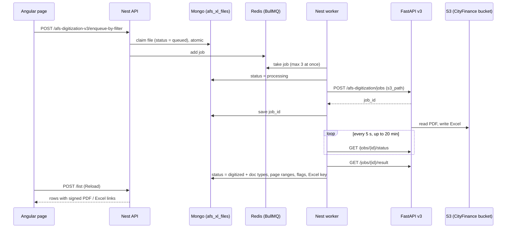

# AFS digitization v3

Admin feature that sends ULB financial-statement PDFs to the FastAPI v3 digitization service
(`/afs-digitization`), and records on `afs_xl_files` what is in each PDF and where its digitized Excel is.

Ticket: TS-1073. Spans three repos:

| Repo                        | What lives there                                                                             |
| --------------------------- | -------------------------------------------------------------------------------------------- |
| `cf-nest-api-v2` (this one) | API, BullMQ queue and worker, Mongo writes. Code in this folder                              |
| `cf-fastapi-v3`             | The digitization itself (OCR, Gemini classification, Excel). `app/routers/afs_digitization/` |
| `cityfinance-ng-ui-v2`      | The admin page, `src/app/admin/afs-digitization-v3/`, route `/afs-digitization-v3`           |

## How it works



1. **Queue.** The admin ticks rows (**Queue Selected**) or uses **Queue All Matching**. The server re-applies the
   filter itself, so "all matching" is not limited to the visible page. Files with no PDF, or already
   queued/processing/digitized, are skipped. The response says how many of each.
2. **Claim.** Each file is moved to `queued` with one atomic Mongo update before a job is added to Redis. Two clicks, or
   two admins, cannot queue the same file twice. If adding to Redis fails, the file is marked `failed` straight away so it
   is not stuck as queued.
3. **Process.** The worker calls FastAPI `POST /afs-digitization/jobs` with the file's stored path as `s3_path`.
   FastAPI reads the PDF from the CityFinance bucket itself; Nest never downloads or uploads the PDF. Classification, the Gemini
   accuracy validation and the arithmetic validation are all on.
4. **Wait.** FastAPI runs the job as a background task. The worker polls its status until it is `completed` or `failed`.
5. **Save.** Nest reads the result and writes a summary to Mongo. The full extraction stays in FastAPI.

## Data model

Stored on `afs_xl_files.ulbFile` (the ULB's PDF). One record per `{ulb, year, auditType, docType}`
(unique index). Only `ulbFile.*` paths are written, so nothing else in the record is overwritten.

| Field                                          | Meaning                                                                                                                                  |
| ---------------------------------------------- | ---------------------------------------------------------------------------------------------------------------------------------------- |
| `digitizationStatus`                           | `queued`, `digitized` or `failed` (existing enum)                                                                                        |
| `queue.status`                                 | `queued`, `processing`, `completed` or `failed`; separates queued from processing                                                        |
| `queue.failedReason`, `digitizationMsg`        | Why it failed, or a non-fatal warning (e.g. Excel not linked)                                                                            |
| `requestId`                                    | **FastAPI job id** (`afsDigitizationJobId`). Saved as soon as FastAPI accepts the job, so running and failed jobs can be traced. Indexed |
| `excelUrl`                                     | Key of the digitized Excel in the CityFinance bucket                                                                                     |
| `pdfUrl`, `noOfPages`, `totalProcessingTimeMs` | Source PDF and job facts                                                                                                                 |
| `detectedDocTypes`                             | Distinct doc types actually present in the PDF                                                                                           |
| `segments`                                     | Page range per type: `{docType, startPage, endPage, title?, isDuplicate}`                                                                |
| `isConsolidated`                               | More than one distinct type is present                                                                                                   |
| `isMismatch`                                   | The uploaded type (`docType` on the record) is **not** among `detectedDocTypes`                                                          |

Rules worth knowing:

- `detectedDocTypes`, `segments`, `isConsolidated` and `isMismatch` are absent until a file has been digitized by v3
  (the schema uses `default: undefined`). Their presence is how v3-digitized files are told apart from files digitized by
  the old flow.
- `unknown` (FastAPI could not identify a page range) is kept in `segments` but is not a type: it does not count as
  present and does not make a file consolidated. A file whose only content is unknown is a mismatch.
- `data[]` (the old flow's parsed Excel rows) is **not** written. The extraction is read from FastAPI by job id.
- The page shows a derived status: `not-digitized`, `queued`, `processing`, `digitized`, `failed`. A file the old flow
  digitized has no `detectedDocTypes`, so it shows as not digitized and can be queued again.

Doc type mapping (`afs-digitization-v3.constants.ts`):

| Nest `docType`        | FastAPI                       |
| --------------------- | ----------------------------- |
| `bal_sheet`           | `BALANCE_SHEET`               |
| `bal_sheet_schedules` | `BALANCE_SHEET_SCHEDULE`      |
| `inc_exp`             | `INCOME_EXPENDITURE`          |
| `inc_exp_schedules`   | `INCOME_EXPENDITURE_SCHEDULE` |
| `cash_flow`           | `CASH_FLOW`                   |

`auditor_report` is not supported here (it lives in `afs_auditors_report`); the API returns 400 for it.

## API

Base path `/api/v2/afs-digitization-v3`. Roles `ADMIN` and `AFS_ADMIN`. Replies are `{ success, data?, … }`.
Note the global `ResponseTransformInterceptor` wraps any reply that has no `success` field, so new endpoints must
return `success` themselves or the client gets a doubly wrapped body.

### `POST /list`

One page of ULBs plus the card counts. Body (`AfsDigitizationV3QueryDto`, extends the AFS dashboard query):

| Field                                        | Notes                                                                                                             |
| -------------------------------------------- | ----------------------------------------------------------------------------------------------------------------- |
| `yearId`, `auditType`, `docType`             | Required. `docType` must not be `auditor_report`                                                                  |
| `stateId[]`, `ulbId[]`, `populationCategory` | Same as the AFS dashboard                                                                                         |
| `digitizationV3Status`                       | `not-digitized`, `queued`, `processing`, `digitized`, `failed`                                                    |
| `isConsolidated`, `isMismatch`               | `true` filters as you expect. `false` returns only files that are digitized and not consolidated / not mismatched |
| `page`, `limit`                              | 1-based page, default limit 100                                                                                   |

Response: `{ success, data[], totalCount, metrics }`. `metrics` covers the whole selection (ignoring the status, consolidated
and mismatch filters): `total, withPdf, notDigitized, queued, processing, digitized, failed, consolidated, mismatch`.

Each row has `ulbName`, `ulbCode`, `stateName`, `pdfUrl` + `pdfUrlSigned`, `pdfPageCount` + `pdfSizeBytes` (from
`annualaccountdatas`, null until the PDF-metadata backfill has run), `excelUrl` + `excelUrlSigned` (only once digitized),
and a `digitization` object: `status, detectedDocTypes, segments, isConsolidated, isMismatch, noOfPages, jobId, excelUrl, error`.

How it stays fast: three reads merged in memory (ULBs with their PDF, the matching states, the existing records), instead
of joining every ULB to `afs_xl_files`. Only a few small `ulbFile` fields are read, never `data[]`.

### `POST /enqueue-by-filter`

Same body as `/list`. Queues every match. Send `ulbId` to queue only specific rows (this is how **Queue Selected** works).
Returns `{ matched, queued, skippedNoPdf, skippedDuplicate, skippedAlreadyQueued, skippedAlreadyDigitized, failedToQueue }`.
Capped at 10,000 files per call (`MAX_ENQUEUE_BATCH`).

**Duplicates.** A slot whose PDF is the same file as an earlier slot of the same ULB, year and audit type is flagged on
`annualaccountdatas` (`<auditType>.provisional_data.<slot>.pdf.isDuplicate` and `.duplicateOfDocType`) by
`POST /afs-digitization/annual-accounts/duplicates/backfill` (`limit`, `onlyMissing`; by default only PDFs not
checked yet, `onlyMissing=false` recomputes all; run the PDF-metadata backfill first). Same file = same url, or same
`fileSizeBytes` and `pageCount`; a slot without that metadata never matches. Slot order is `bal_sheet`,
`bal_sheet_schedules`, `inc_exp`, `inc_exp_schedules`, `cash_flow`; the first is the original. Duplicates are skipped here
(`skippedDuplicate`), and in `/list` a duplicate row follows its original's status, Excel and segments, carries
`isDuplicate` and `duplicateOfDocType`, and is counted in `metrics.duplicate`.

### `GET /jobs/:afsDigitizationJobId/log`

FastAPI's record of one job: status, progress step, error, warnings, file, pages, detected type, engine and model, cost,
timestamps. The id must be 32 hex characters (400 otherwise); 404 if FastAPI has no such job; 502 if FastAPI is unreachable.
This is the job record, not a step-by-step history. FastAPI keeps only the current step, the final error and the warnings.

## Queue (Redis and BullMQ)

| Setting    | Value                                                                                                                            |
| ---------- | -------------------------------------------------------------------------------------------------------------------------------- |
| Queue name | `afsDigitizationV3` (`AFS_DIGITIZATION_V3_QUEUE`)                                                                                |
| Redis      | `REDIS_URL`; keys prefixed `appq:` (or `BULL_QUEUE_PREFIX`). Set up once in `app.module.ts`                                      |
| Worker     | `AfsDigitizationV3Processor`, in the Nest process, concurrency **3**                                                             |
| Attempts   | 2, exponential backoff starting at 30 s                                                                                          |
| Retention  | Completed jobs kept 24 h (max 1000), failed kept 7 days (max 1000)                                                               |
| Job id     | `digitize-v3-<ulb>-<year>-<auditType>-<docType>-<timestamp>`. Unique per request, so a kept finished job never blocks a re-queue |

Redis holds only the queue. The status the page shows comes from Mongo, never from Redis.

Why concurrency is capped: FastAPI runs jobs as in-process background tasks with no limit of its own, and each worker slot is
held while FastAPI works.

Retries:

- Server errors and timeouts are retried once; the file shows as `queued` in between.
- Client errors (4xx except 408 and 429) and a missing `AFS_DIGITIZATION_V3_URL` are **not** retried (`UnrecoverableError`).
- After the last attempt the file is `failed` with the reason saved.

If Nest restarts mid-job, BullMQ puts the job back on the queue and the worker submits a new FastAPI job. The old FastAPI
job is orphaned and may still run. The newer job id replaces it in Mongo.

If Redis is wiped while files are `queued` in Mongo, they stay `queued` and later queue clicks skip them. Nothing resets them
automatically.

Bull Board is at `/admin/queues` (basic auth from `ADMIN_USER` and `ADMIN_PASSWORD`); the queue is registered in
`afs-digitization.module.ts`.

## Excel

FastAPI writes the workbook to **`S3_BUCKET_CF`** and reports the bucket (`excel_s3_bucket`) and key (`excel_s3_key`) in the
job result. Nest stores the key in `ulbFile.excelUrl` and signs it (`FileTokenService.signFileUrl`) exactly like the PDF, so
the browser downloads it from Nest, not FastAPI.

Nest only keeps the key when the bucket FastAPI reports equals Nest's own `AWS_BUCKET_NAME`. Otherwise the file is still
`digitized`, no Excel link is stored, and a warning is saved in `digitizationMsg` (shown as the status tooltip). The job is not
failed, because re-running it would repeat the paid Gemini work.

**`S3_BUCKET_CF` (FastAPI) and `AWS_BUCKET_NAME` (Nest) must be the same bucket.** It holds the ULB PDFs FastAPI reads and the
Excel it writes.

## Page

Route `/afs-digitization-v3` (`authGuard`; no nav menu entry). Table styled like `/afs-dashboard`.

- Filters: the shared AFS filter sidebar, plus status, contents (consolidated / single) and uploaded type (mismatch / matches)
  in the same sidebar. The extra three apply as soon as picked.
- Row checkbox, **Queue Selected**, **Queue All Matching**, **Reload**. The list does **not** auto-refresh; press Reload to see
  queued files move on. Selection is kept across pages and cleared when a filter changes.
- Uploaded PDF shows a PDF link with page count and size. The Excel icon sits beside the status badge.
- Three-dot menu: **View log** (dialog, via the log endpoint) and **View job** (opens
  `<urlV2>/ocr/afs-digitization/upload?jobId=…` in a new tab).

## Configuration

Nest `.env`:

| Variable                               | Purpose                                                                                                                            |
| -------------------------------------- | ---------------------------------------------------------------------------------------------------------------------------------- |
| `AFS_DIGITIZATION_V3_URL`              | FastAPI base, without `/afs-digitization` (e.g. `https://dev.cityfinance.in/api/v3`, or `http://localhost:8000` locally). Required |
| `AFS_DIGITIZATION_V3_TIMEOUT_MS`       | Per-request timeout, default 120000                                                                                                |
| `AFS_DIGITIZATION_V3_POLL_INTERVAL_MS` | Status poll interval, default 5000                                                                                                 |
| `AFS_DIGITIZATION_V3_MAX_WAIT_MS`      | Give up waiting for one job after this, default 1200000 (20 min)                                                                   |
| `REDIS_URL`, `BULL_QUEUE_PREFIX`       | Redis connection and key prefix                                                                                                    |
| `AWS_BUCKET_NAME`                      | Bucket Nest signs files from; must equal FastAPI's `S3_BUCKET_CF`                                                                  |

FastAPI: `S3_BUCKET_CF` (see `app/routers/afs_digitization/README.md`).

Deploy FastAPI before Nest. Against an older FastAPI the bucket is not reported and no Excel link is stored.

## Troubleshooting

| Symptom                                    | Likely cause                                                                                                                   |
| ------------------------------------------ | ------------------------------------------------------------------------------------------------------------------------------ |
| Job fails at once with a FastAPI 4xx error | `pdfUrl` is not in FastAPI's `S3_BUCKET_CF` (bucket mismatch), or it is not a PDF                                              |
| Digitized but no Excel icon                | Bucket mismatch: read the status tooltip. Or the file was digitized before the Excel moved to `S3_BUCKET_CF`; re-queue it      |
| File stuck as `queued`                     | Redis was cleared, or Nest was down. Re-queue is skipped while Mongo says `queued`; reset `ulbFile.digitizationStatus` by hand |
| Nothing in Bull Board                      | Finished jobs are kept 24 h / 7 d. Look in the Completed and Failed tabs, and check the prefix                                 |
| `View log` shows 404                       | FastAPI has no job with that id (different FastAPI instance or database)                                                       |
| Page count / size empty                    | PDF-metadata backfill has not run for that file (`POST /afs-digitization/annual-accounts/pdf-metadata/backfill`)               |

Redis check:

```
redis-cli -u "$REDIS_URL" keys 'appq:afsDigitizationV3:*'
redis-cli -u "$REDIS_URL" get appq:afsDigitizationV3:id        # jobs ever added
```

## Known limitations

- Auditor's report is not supported.
- Only the ULB's PDF (`ulbFile`) is handled, not AFS-uploaded files (`afsFile`).
- Files digitized by the old flow show as not digitized here. Files digitized before the Excel moved to `S3_BUCKET_CF` have no
  usable Excel link. Re-queue both.
- The extraction is not stored in Mongo. Anything that needs the table data must read it from FastAPI by job id.
- The job log is FastAPI's job record, not a step-by-step history.

## Files

| File                                       | Role                                                                                 |
| ------------------------------------------ | ------------------------------------------------------------------------------------ |
| `afs-digitization-v3.controller.ts`        | The three endpoints                                                                  |
| `afs-digitization-v3.service.ts`           | List, enqueue-by-filter, and all Mongo writes (claim, processing, digitized, failed) |
| `afs-digitization-v3-queue.service.ts`     | Calls FastAPI, polls, maps the result, job log                                       |
| `afs-digitization-v3.processor.ts`         | BullMQ worker (concurrency 3)                                                        |
| `afs-digitization-v3.constants.ts`         | Doc type maps, job and result types, limits                                          |
| `../dto/afs-digitization-v3-query.dto.ts`  | Request body                                                                         |
| `src/schemas/afs/afs-excel-file.schema.ts` | `ulbFile` fields                                                                     |
| `src/schemas/afs/enums.ts`                 | `DigitizationV3Statuses`                                                             |
| `src/core/constants/queues.ts`             | Queue name                                                                           |
